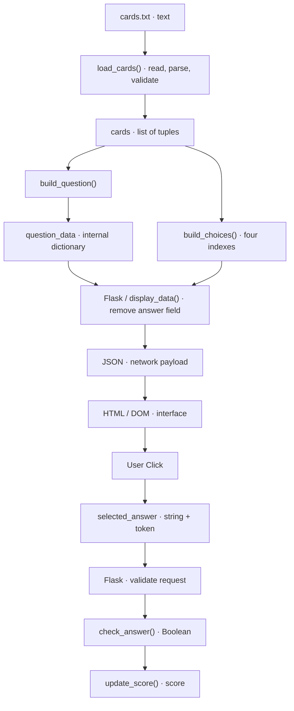

# Primary data-flow diagram

Text equivalent: `cards.txt → load_cards() → cards → build_question() → question_data → Flask → JSON → HTML → User Click → selected_answer → Flask → check_answer() → score`.

The author owns raw text. Python owns validated cards and evaluates answers. The browser owns the DOM and pending click. Each arrow is a handoff, not necessarily a network call: only Flask↔browser crosses HTTP. The answer field stays out of the public display payload.
