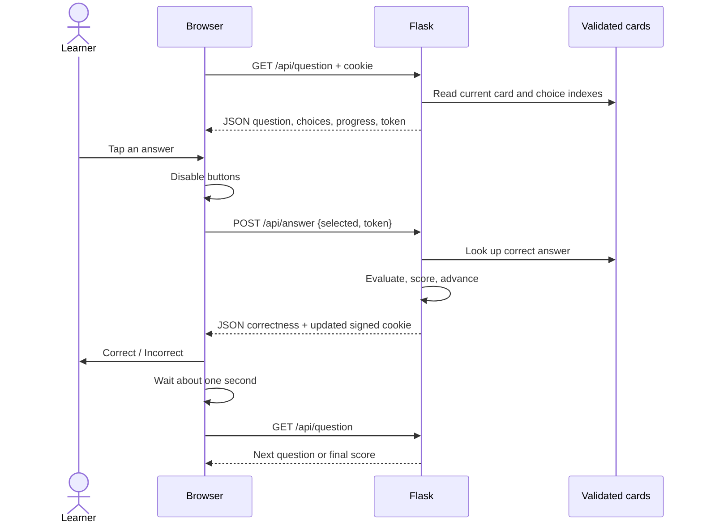

# One-question communication sequence

On the first visit, a missing quiz returns 409, so the browser first POSTs `/api/start`. A refresh only GETs current state. An uncertain failed POST is never automatically resent. No database participates in this sequence.
